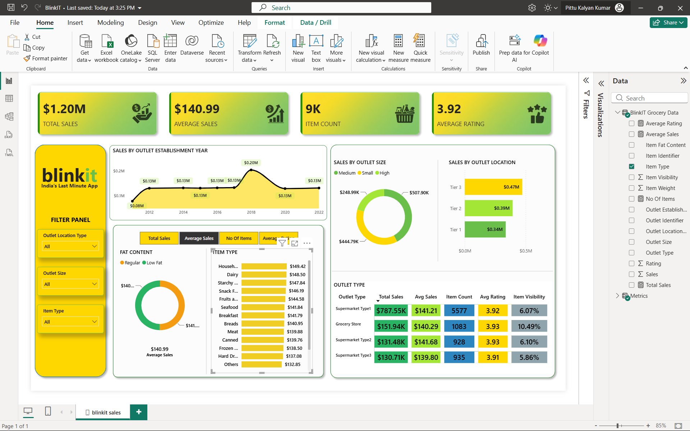

# BlinkIT Sales Analysis

An interactive Power BI report exploring BlinkIT grocery sales across products and outlet characteristics. The report summarizes revenue, average sales, item–outlet record counts, and ratings, with slicers for outlet location type, outlet size, and item type.

## Dashboard preview

## Project files

- `BlinkIT.pbix` — Power BI report.
- `BlinkIT Grocery Raw Data.xlsx` — source workbook, with 8,523 records and 12 columns.

## Business questions

The report examines:

- How sales and selected metrics vary by item fat content and item type.
- How sales vary by outlet establishment year.
- How sales are distributed across outlet sizes and location tiers.
- How the main metrics compare across outlet types.

The original brief also asks for sales by fat content within outlet. The current report does not include a dedicated visual for that comparison.

## Dashboard guide

The top cards show Total Sales, Average Sales, No Of Items, and Average Rating. The line chart shows sales by outlet establishment year. The outlet-size donut compares sales by outlet size, while the horizontal bar chart compares sales across location tiers. The lower-left charts show sales by fat content and item type. The metric selector changes the measure used by those two charts. The table compares outlet types across the main measures and average item visibility.

Use the slicers on the left to filter by outlet location type, outlet size, and item type. Click an empty area of the report canvas to clear a visual selection.

## Measures and interpretation

- **Total Sales:** total sales value; the saved dashboard displays approximately **$1.20M**.
- **Average Sales:** average sales value per row; the saved dashboard displays **$140.99**.
- **No Of Items:** calculated with `COUNTROWS('BlinkIT Grocery Data')`. This counts **8,523 item–outlet records**, not distinct product identifiers. The source contains **1,559 distinct item IDs**.
- **Average Rating:** calculated with `AVERAGE('BlinkIT Grocery Data'[Rating])`. The saved dashboard displays **3.92**. A direct average of the supplied workbook’s Rating column is approximately **3.97**, so the displayed value and source calculation do not currently reconcile.
- **Average Item Visibility:** shown as a percentage in the outlet-type table.

The “No Of Items” and “Average Rating” notes preserve the definitions and values in the current report; they are included so readers can interpret the dashboard accurately.

## Key observations

- Total sales in the workbook are approximately **$1.20M**.
- **Supermarket Type1** has the largest total sales among outlet types, at about **$787.55K**.
- **Tier 3** has the highest sales among location tiers, at about **$472.13K**.
- **Medium** outlets have the highest sales among outlet sizes, at about **$507.90K**.
- The report groups the raw fat-content labels into **Low Fat** and **Regular** for comparison.

## Data notes

- The workbook contains **1,463 blank Item Weight values**. Item Weight is not used in the current dashboard visuals or listed measures.
- The raw Fat Content column contains label variants such as `LF`, `low fat`, and `reg`; the report presents the normalized groups **Low Fat** and **Regular**.
- Sales figures are shown in the units provided by the source workbook.

## Tools

- Microsoft Excel for the source workbook.
- Microsoft Power BI for the interactive report, measures, slicers, and visuals.

